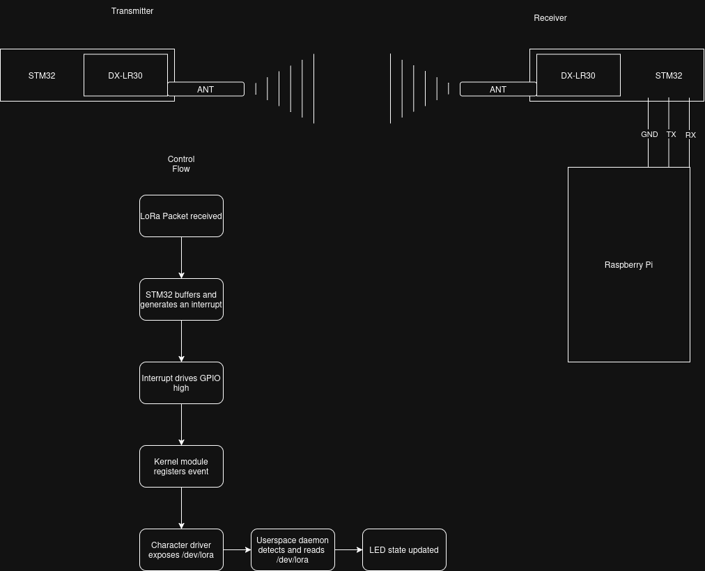

### [Project Schedule](https://github.com/users/DysonTheSphere/projects/1/views/2)
# Overview
This project serves to demonstrate LoRa communication between a transmitter and a receiver with the purpose of acting as a controller. It will do so by sending commands from a DX-LR30 module that are terminally received from a Raspberry Pi connected to an additional DX-LR30 and exposed via a POSIX-compliant Linux kernel driver. A lightweight interrupt-based daemon will monitor for a communication event from the connected DX-LR30 acting as a receiver, and subsequently drive a pair of LEDs based on the received instruction.

My motivations stem from a long-standing interest in LoRa, specifically the unlicensed 915 MHz ISM band.

This spectrum is idyllic for open source telecommunication as it is:
- low-power
- low-cost
- long-range

My long term plan after Fall 2026 is to extend this project into an automotive keyless entry system.

# Target Build System
Buildroot will generate an embedded Linux image targeting a Raspberry Pi (TBD from E-Store stock).

# Hardware Platform
A Raspberry Pi as supported [here](https://sites.google.com/colorado.edu/ecen5713/home#h.p_IoQKPtPXE5f6)

Two **DX-SMART LR-30** which consists of:
- Semtech SX1262
- STM32 Blue Pill[^1]
[^1]: [STM32F103C8T6](https://stm32-base.org/boards/STM32F103C8T6-Blue-Pill.html)

# Open Source Projects Used
| Project | Purpose   |
| --- | --- |
| LoRaModule | DX-SMART supplied firmware for DX-LR30 |
| STM32Cube HAL | Peripheral abstraction for STM32 Receiver |
| libgpiod | Controlling on-board LEDs from user-space |
| RadioLib | stretch goal to directly connect to SX1262 module |

# Previously Discussed Content
### Buildroot Image Generation 
Configuring a custom root filesystem, compilation toolchain, and tree overlays for the target device.
### Linux Kernel Modules
Writing a loadable character device driver implementing `read()` operation
### System Programming
Developing a user-space daemon with signal handling and logging.
### IPC & Synchronization
Coordinating data flow and blocking operations between kernel- and user-space.

# New Content
### Hardware interrupts in Kernel Space
Using the Linux GPIO descriptor interface and irq system to capture interrupt events.
### User-Space GPIO Control
Integrating `libgpiod` into Buildroot and the user-space daemon.
### LoRa RF Link & AT Commands
Configuring and operating the two 915 MHz DX-LR30 transceivers for UART PTP communication.

# Shared Material
Absolutely none!

# Source Code Organization
This final-project- repository will contain the buildroot configuration.\
The rest of the project source will exist in the [LoRa-RC repo.](https://github.com/DysonTheSphere/final-project-assignment-LoRa-RC)
- **`driver/`**: Custom character driver handling GPIO interrupts
- **`daemon/`**: User-space C daemon to monitor the driver and control LEDs via `libgpiod`.
- **`receiver/`**: AT configuration and reference for the Pi-ified DX-LR30.
- **`transmitter/`**: AT configuration and reference for the standalone DX-LR30.
- **`doc/`**: Hardware pinouts, diagrams, and other miscellany.

# Stretch Goals
A stretch goal is connect the SX1262 breakout directly to the Raspberry Pi without the second STM32 as a receiver.
